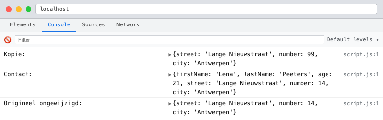
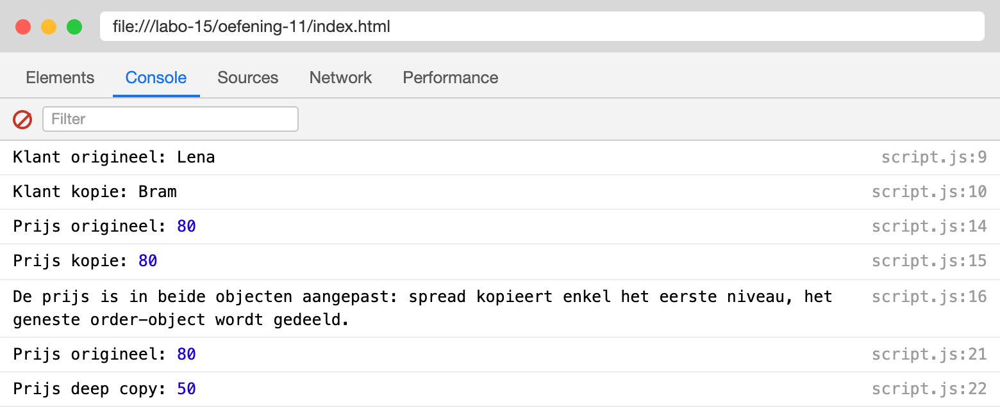
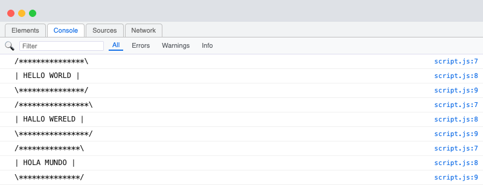
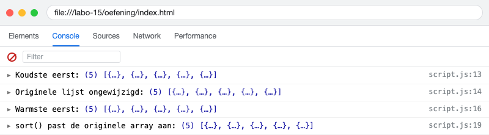
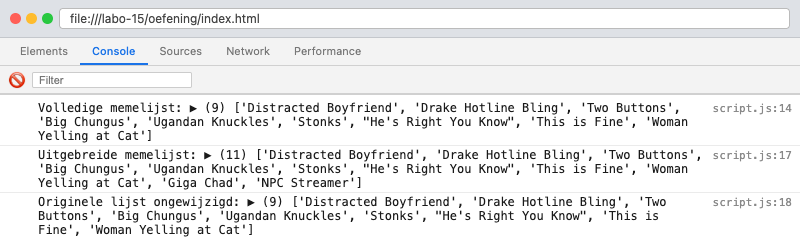

# Labo 15

Zorg dat je de volgende folderstructuur volgt:

```
webtechnologie/
├─ labo-01/
│  ├─ oefening-01/
│  │  ├─ index.html
│  │  ├─ images/
│  │  │  ├─ image-1.jpg 
│  │  │  └─ image-n.jpg 
│  │  ├─ css/
│  │  │   ├─ normalize.css
│  │  │   └─ style.css
│  │  ├─ data/
│  │  │   ├─ datafile-1.json
│  │  │   └─ datafile-2.json
│  │  └─ js/
│  │     └─ script.js
│  ├─ oefening-02/
│  └─ oefening-n/
├─ labo-02/
└─ labo-n/      
```

- Gebruik steeds JS modules om globale variabelen te vermijden (`<script type="module" src="./path/to/script.js"></script>`)
- Volg de [Coding Guidelines](https://webtechnologie.programmeren-ap.be/coding-guidelines)

## Oefeningen

### oefening 1: spread operator met objecten

#### leerdoelen

* spread-operator gebruiken om objecten te kopiëren
* spread-operator gebruiken om objecten samen te voegen
* begrijpen dat spread een kopie maakt (geen referentie)

#### functionele analyse

Het programma maakt kopieën en combineert objecten met de spread-operator.

#### technische analyse

Gebruik de volgende objecten:

```js
const address = { street: "Lange Nieuwstraat", number: 14, city: "Antwerpen" };
const person  = { firstName: "Lena", lastName: "Peeters", age: 21 };
```

1. Maak een kopie van `address` met de spread-operator en verander het huisnummer naar 99.
2. Voeg `address` en `person` samen tot één nieuw object `contact` met de spread-operator.
3. Print de kopie, `contact` en het originele `address` af in de console.
4. Toon dat het originele `address` object ongewijzigd is.

#### voorbeeldinteractie



### oefening 2: shallow of deep copy?

#### leerdoelen

* begrijpen dat de spread-operator enkel het eerste niveau kopieert
* een echte kopie maken van een genest object met `structuredClone()`

#### functionele analyse

Het programma past een bestelling aan in een kopie van een object, en toont wanneer het origineel toch mee verandert.

#### technische analyse

Gebruik het volgende object:

```js
const cart = {
    customer: "Lena",
    order: { product: "Koptelefoon", price: 100 }
};
```

1. Maak met de spread-operator een kopie `shallowCopy` van `cart` en verander daarin de klant naar "Bram".
2. Print `cart.customer` en `shallowCopy.customer` af en toon dat de klant in `cart` nog altijd "Lena" is.
3. Verander nu in `shallowCopy` de prijs naar 80 (`shallowCopy.order.price`) en print de prijs van beide objecten af. De prijs in `cart` is nu ook 80, want het geneste `order`-object wordt gedeeld.
4. Maak een `deepCopy` met `structuredClone(cart)`, verander daarin de prijs naar 50 en print de prijs van beide objecten af. Deze keer blijft de prijs in `cart` op 80 staan.

#### voorbeeldinteractie



### oefening 3: opwarmers
Schrijf de volgende functies om aan te tonen dat je alle concepten onder de knie hebt:

* Schrijf een functie zonder argumenten die een getal teruggeeft.
* Schrijf een functie zonder argumenten die een string teruggeeft.
* Schrijf een functie zonder argumenten die een boolean teruggeeft.
* Schrijf een functie zonder argumenten die een string afprint in de console.
* Schrijf een functie met twee argumenten (twee getallen) die een getal op het scherm afprint. Het getal dat wordt getoond moet iets doen met deze twee getallen.
* Herschrijf die laatste functie in arrow notatie.
* Schrijf een arrow functie met 1 parameter die een getal verdubbelt. Gebruik de verkorte notatie: zonder accolades en zonder `return`.
* Schrijf een functie `multiply` met twee parameters, waarbij de tweede parameter een standaardwaarde 2 heeft. Roep ze een keer aan met 1 argument en een keer met 2 argumenten.

### oefening 4: text-box-functie

#### leerdoelen

* input lezen
* schrijven van eigen functies

#### functionele analyse

Je programma toont een stuk tekst in je console in een tekstvak

#### technische analyse

Je kan de code om een box te tekenen hergebruiken uit labo-12, oefening 14. Je moet ze wel nog omzetten naar een functie.

Je maakt een functie `printTextBox` met een string als parameter. De functie toont de tekst in het tekstvak.

Je roept de functie een aantal keer aan met verschillende parameters.

#### voorbeeldinteractie



### oefening 5: sorteren

#### leerdoelen

* een array van objecten sorteren met `sort()`
* een compare-functie schrijven die op een property van een object vergelijkt
* begrijpen dat `sort()` de originele array aanpast

#### functionele analyse

Het programma sorteert een lijst steden op temperatuur, en toont wat `sort()` met het origineel doet.

#### technische analyse

Gebruik de volgende array:

```js
const cities = [
    { name: "Gent", temperature: 12 },
    { name: "Antwerpen", temperature: 4 },
    { name: "Hasselt", temperature: 25 },
    { name: "Brugge", temperature: 9 },
    { name: "Leuven", temperature: 7 },
];
```

1. Schrijf een functie `compareTemperature(a, b)` die `a.temperature - b.temperature` teruggeeft.
2. Maak met de spread-operator een kopie van `cities` en sorteer die met `compareTemperature`, zodat de koudste stad eerst komt. Print de gesorteerde lijst en het originele `cities` af.
3. Sorteer ook een kopie met de warmste stad eerst, met een arrow functie als compare-functie.
4. Sorteer tot slot `cities` zelf (zonder kopie) en print de array af om aan te tonen dat `sort()` het origineel aanpast.

#### voorbeeldinteractie



### oefening 6: memes combineren met rest-parameters

#### leerdoelen

* rest-parameters gebruiken in functies (`...args`)
* spread-operator gebruiken in combinatie met functies
* aantonen dat spread een kopie maakt (geen referentie)

#### functionele analyse

Het programma combineert lijsten van memes uit verschillende categorieën tot één grote memelijst.

#### technische analyse

Gebruik de volgende arrays:

```js
const classicMemes   = ["Distracted Boyfriend", "Drake Hotline Bling", "Two Buttons"];
const deepFriedMemes = ["Big Chungus", "Ugandan Knuckles", "Stonks"];
const currentMemes   = ["He's Right You Know", "This is Fine", "Woman Yelling at Cat"];
```

1. Schrijf een functie `combineMemes(...memeCategories)` die een variabel aantal arrays ontvangt en ze samenvoegt tot één array met de spread-operator.
2. Roep de functie aan met de drie arrays, sla het resultaat op in `fullMemeList` en print de lijst af.
3. Maak een kopie van `fullMemeList` met de spread-operator en voeg twee extra memes toe aan de kopie.
4. Print beide lijsten af en toon dat `fullMemeList` ongewijzigd is.

#### voorbeeldinteractie



